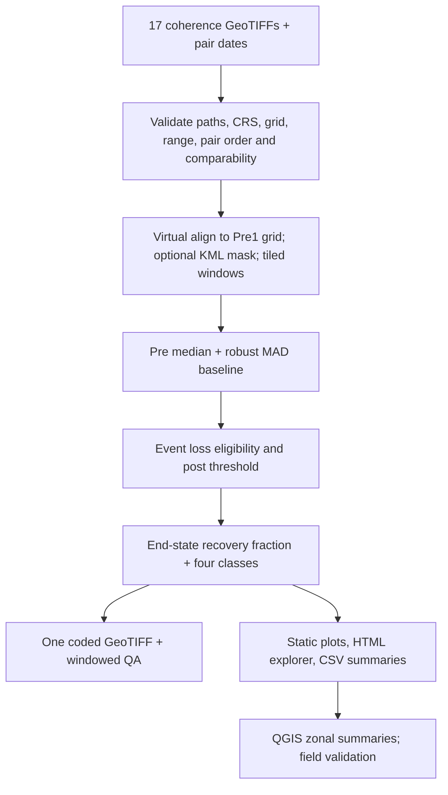

# Infanta SAR Coherence Time-Series Workflow

**Research ITSA revision:** the default `RECOVERY_MODEL="itsa"` now dispatches to
the fitted, object-based research pipeline. Read [ITSA_RESEARCH_METHOD.md](ITSA_RESEARCH_METHOD.md)
for current equations, configurable provisional thresholds, outputs, limitations
and QGIS instructions. The earlier descriptive workflow documented below is
preserved with `RECOVERY_MODEL="legacy_observed"`; its observed-only classes must
not be described as ITSA-derived. No new raster results have been validated.

This project analyzes 17 already-produced interferometric coherence magnitude rasters (8 pre-event, 1 event-associated, 8 post-event). It does **not** make interferograms from SLC data. The event is Typhoon Noru/Karding, September 2022. All pair dates, acquisition comparability, local event window and thresholds must be confirmed from product metadata and the study protocol before a research run.

## Recommended library stack

| Library | Function and use here | Strengths / limits | Status and integration |
|---|---|---|---|
| Rasterio (GDAL-backed) | Read metadata and windows; mask; virtual warp; write GeoTIFF | Strong geospatial semantics and windowed I/O; one band-oriented workflow, not a labeled multidimensional cube | Essential; primary raster engine |
| GDAL | Format/driver and warp engine beneath Rasterio | Broad format and command-line coverage; direct bindings add setup complexity | Essential transitively; use `gdalinfo` for independent inspection if available |
| NumPy | Masked arrays, robust pixelwise statistics and metrics | Fast and transparent; whole-scene arrays can exhaust RAM | Essential; process 256-pixel tiles |
| Pandas | Observation, time-series, sensitivity and zonal CSVs | Convenient tabular summaries; not suited to holding all raster cells | Essential for outputs |
| Matplotlib | Static thesis figures in PNG/SVG/PDF | Publication control and vector exports; interactivity is limited | Essential |
| SciPy | Theil–Sen descriptive trend | Robust slope estimator; pixels are spatially dependent and 8 post observations are sparse, so no inferential p-value is claimed | Recommended |
| Shapely + PyProj | Parse KML polygons and transform from KML WGS84 to raster CRS | Explicit geometry behavior; valid polygon KML only; no automatic topology repair | Recommended; used for optional zones |
| Plotly | Hoverable HTML time series | Useful exploration; not a substitute for static thesis figures | Optional |
| GeoPandas | General vector reading/overlay and zone table work | Convenient but adds Fiona/pyogrio stack; KML driver availability varies | Optional; not required for this KML workflow |
| Xarray + rioxarray | Labeled `(time, y, x)` arrays and raster CRS metadata | Excellent when rasters fit/dask-backed lazy workflows or NetCDF/Zarr are central; can hide costly reads and is unnecessary for this bounded 17-file window pipeline | Optional alternative |
| Dask | Distributed/lazy chunked computation | Helps larger-than-memory or parallel workloads; chunk alignment and scheduler overhead need care | Optional at larger scale; Rasterio windowing is simpler here |
| Statsmodels | Regression, robust covariance, time-series models | Only 9 event/post points make complex time-series models underpowered; avoid treating pixels as independent replicates | Optional, not used by default |
| scikit-learn | Clustering/classification if validated labels exist | Can discover patterns but introduces tuning/validation burden and is not needed for descriptive recovery | Optional future work |
| Seaborn | Statistical chart conveniences | Nice defaults, less precise for multi-panel geospatial story than direct Matplotlib | Optional |
| Bokeh / Altair | Interactive browser charts | Good HTML interactions; additional dependencies and no scientific benefit over Plotly for this limited series | Optional alternatives |
| exactextract / rasterstats | Polygon zonal extraction | `exactextract` supports fractional coverage; rasterstats is straightforward; neither is needed for coded status counts and windowed summaries already implemented | Recommended for a separate fractional-pixel sensitivity analysis; not required |

**Practical recommendation:** Rasterio + NumPy + Pandas + Matplotlib + SciPy + Shapely/PyProj, with Plotly optional. Rasterio's VRT resampling uses bilinear by default here, appropriate for continuous coherence magnitude; it is not a correction for poor coregistration and can smooth data. For an unchanged grid, no resampling is done. For deliberate downsampling, consider `average`; nearest-neighbor is useful as a resampling sensitivity check. Never upsample one dataset and imply its native resolution improved. Rasterio documents reprojection, resampling, and windowed access in its [reprojection](https://rasterio.readthedocs.io/en/stable/topics/reproject.html), [resampling](https://rasterio.readthedocs.io/en/stable/topics/resampling.html), and [windowed I/O](https://rasterio.readthedocs.io/en/latest/topics/windowed-rw.html) guides. `rioxarray` extends Xarray's labeled-array model with raster georeferencing; see [Xarray raster I/O](https://tutorial.xarray.dev/fundamentals/01.1_io.html).

## Scientific decisions and limits

### Pair-time representation

Each coherence raster summarizes two acquisitions, master `t_m` and slave `t_s`, so a single timestamp loses information. `config.py` stores both. The default analysis reference is pair end `max(t_m,t_s)`: it is a conservative timestamp for the period over which the surface could have changed. Pair midpoint is available as a sensitivity case. Figures show the chosen reference and draw a horizontal segment across each pair's full acquisition interval. Do not call a pair an instantaneous observation. Event-associated pairs must overlap the configurable event window; post pairs must begin after it; pre pairs must end before it. The event origin is a calendar reference for elapsed-time reporting, not a satellite acquisition.

The default event window is a UTC day envelope around Noru's September 25 Philippine landfall. Refine it using PAGASA/local impacts and actual pair dates. Check that every pair is comparable: same relative orbit/direction, polarization, beam/burst, processing chain, coherence window and geometric processing. Pair temporal baseline differences change expected temporal decorrelation. The script warns/errors on a configured baseline ratio; its default 1.25 gate is a screening choice, not a universal scientific threshold. Set an override only with a documented rationale.

### Metrics

For pixel `p`, pre-event baseline is the median of its 8 pre pairs:

`B_p = median(γ_p,pre,i)`; robust spread `S_p = 1.4826 × median(|γ_p,pre,i − B_p|)` (MAD scaled to Gaussian sigma).

Baseline eligible requires at least `MIN_PRE` valid pairs, `B_p >= BASELINE_MIN`, and `S_p <= BASELINE_MAD_MAX`. This filters uninformative water/low-coherence pixels and unstable baselines; report that the target population is consequently stable, observable pixels, not every built-up pixel.

Event-associated absolute loss is `L_p = B_p − γ_p,event`. It is detectable if `L_p >= max(LOSS_ABSOLUTE, LOSS_MAD_MULTIPLIER × max(S_p, NOISE_FLOOR))`. This is a configurable operational threshold, not a calibrated significance test. Event coherence is attributable to Noru only when the pair interval and external event evidence support that attribution.

The primary output is one **two-band Float32 GeoTIFF**. Band 1 is end-state recovery fraction `R_p = (P_end − E_p)/(B_p − E_p)`, where `P_end` is the median coherence from exactly the latest three post-event pairs. Values are not clipped: `R<0` means the end-state coherence is below the event-pair value; `R=0` means none of the event loss has been regained; `R=1` means the event loss has been regained to the baseline value; `R>1` means it exceeds the baseline. Band 1 is NoData for class 4 because recovery fraction is not meaningful where the loss denominator is not detectable. 

Band 2 contains exactly-valued integer class codes stored as Float32: `1` recovered (both latest consecutive post pairs meet `B_p − δ`); `2` partially recovered (loss detectable, not class 1, and `R>0`); `3` not recovered (loss detectable, not class 1, and `R<=0`); `4` no detectable event-associated loss; `-9999` NoData (invalid/unstable baseline, missing event, too few latest post pairs for classes 1–3, or outside the optional analysis mask). Recovery classes 1–3 also require all `ENDSTATE_POST_PAIRS` latest post pairs to be valid. Excessive pair-reference gaps or overlapping confirmation pairs prevent class 1 unless explicitly allowed. Thresholds are configurable operational definitions, not universal constants; inspect sensitivity runs.

The raster is tiled 256×256 DEFLATE GeoTIFF with Float32, predictor 3, `BIGTIFF=IF_SAFER`, both bands tagged NoData `-9999`, and the reference grid preserved. Band descriptions and tags record formulas, classes, thresholds, pair-date convention and interpretation limits. Do not average class codes. For zonal statistics, summarize Band 2 class counts/proportions; calculate Band 1 mean/median/std/quantiles only where Band 2 is 1–3. Report recovered fraction among eligible pixels as class 1 / (classes 1+2+3), excluding class 4 and NoData.

The indicator measures coherence return, not confirmed building reconstruction. Moisture, vegetation, surface roughness, temporal decorrelation, sensor geometry and processing can change coherence. Field validation, building/damage inventories, optical imagery and weather context are necessary for physical-recovery claims. For eight post observations, complex parametric recovery curves are not justified; plot the irregularly spaced points, use descriptive robust slopes, and report sensitivity to thresholds and confirmation count. Spatial pixels are autocorrelated and do not constitute independent replicates for ordinary pixel-level significance tests.

## Workflow



All inputs are expected inside `PROJECT_ROOT` for this project-scoped workflow. This guard prevents accidentally processing paths outside the research workspace. Put/copy the rasters and KML in the project tree, then enter their full absolute paths in `config.py`.

## Configuration and run

1. Install Python 3.10+ (a fresh environment recommended). From PowerShell:

   ```powershell
   cd "C:\Users\Arlan\OneDrive\Desktop\Jhonjhon\Remote Sensing Research\Codes\sar_coherence"
   py -m venv .venv
   .\.venv\Scripts\Activate.ps1
   python -m pip install --upgrade pip
   pip install -r requirements.txt
   ```

2. Edit `config.py`. Fill `Pre1`…`Pre8`, `During`, `Post1`…`Post8`, `Output_Folder`, and optionally `Study_Area` (polygon KML). Set each `PAIR_DATES["Pre1"] = ("master ISO date", "slave ISO date")` with the actual product acquisition dates. Do not enter the Noru storm date as an image date. Verify product dates in source metadata/processing records; timezone-naive values are interpreted as UTC.
3. Confirm `ACQUISITION_COMPARABILITY_CONFIRMED = True` only after checking orbit, polarization, processing and coherence parameters, and write `COMPARABILITY_NOTES`. Choose the event window/origin using actual local event evidence. Review thresholds with baseline distributions and sensitivity outputs; don't use the defaults as universal constants.
4. Run `python run_analysis.py` from the folder, Jupyter (`%run run_analysis.py`) or VS Code. Empty paths/dates intentionally cause validation errors. Processing is tiled and uses an output directory; it will not invent observations.

Outputs: `Infanta_Coherence_Recovery_Fraction_and_Class.tif`, inventory/date/summary/sensitivity CSVs, `processing.log`, `run_manifest.json`, static figures in configured PNG/SVG/PDF, and optional Plotly HTML. With KML zones, the script also exports per-zone class counts/proportions and recovery-fraction summaries.

## Figures

The figures are intentionally limited to distinct questions: (1) pair-aware overall mean and sampled spatial quantiles; common complete-case pixels hold spatial support fixed, and spatial IQR is not a confidence interval; (2) pixel anomaly from its own pre median; (3) pre/event/post pixel distributions, with eight-pair phase medians per pixel to avoid pretending the unequal observations are equal independent samples; (4) normalized fraction of detected event loss regained through time; (5) zone-by-date coherence heatmap; (6) distribution of the final unclipped recovery fraction; (7) zonal trajectories. Each static figure is saved at configured DPI (>=300) to PNG, SVG and PDF. Dates use actual pair reference dates and the event window is marked. Plotly HTML is exploratory only.

## Zonal statistics and QA

The KML is assumed EPSG:4326 per KML convention and transformed to the raster CRS. `ALL_TOUCHED=False` uses pixel-center inclusion; rerun with `True` as a boundary sensitivity scenario. It is not fractional-area weighting. The generated zonal CSV reports class counts/shares and recovery-fraction mean, median, standard deviation, quartiles, min and max for classes 1–3 only. QGIS zonal analysis should use the same rule: never average Band 2 codes; exclude class 4 and NoData from Band 1 summaries. Consider area-weighted fractional extraction for narrow zones.

### After the run: QGIS workflow

1. In QGIS choose **Layer → Add Layer → Add Raster Layer** (or drag `Infanta_Coherence_Recovery_Fraction_and_Class.tif` into the map). Check **Layer Properties → Information**: it should report the input CRS/grid, 2 Float32 bands, and NoData `-9999`.
2. For the categorical map, duplicate the raster layer if you also want the continuous layer visible. In **Properties → Symbology**, choose **Paletted/Unique values** (or **Paletted raster**), select **Band 2**, classify values, and ensure only codes `1, 2, 3, 4` are rendered. Apply: `1 Recovered #009E73`; `2 Partially recovered #E6AB02`; `3 Not recovered #D55E00`; `4 No detectable event loss #0072B2`. Leave `-9999` transparent/unclassified. Name the layer using the class labels and add a legend note that these are coherence-response classes, not verified building reconstruction.
3. For the continuous map, style the duplicate with **Singleband pseudocolor**, select **Band 1**, and choose a diverging ramp with its midpoint at `0` (negative values below zero, positive values above zero). Do not clip the raster values. Use the legend title **End-state coherence recovery fraction (dimensionless)**; `0` means no net event loss regained and `1` means the event loss returned to baseline. Band 1 is NoData for class 4 and invalid pixels. Usually show either the class layer or fraction layer at a time, since both occupy the same cells.
4. To produce polygon class counts, open **Processing Toolbox → Zonal histogram**. Select the built-up-area/barangay polygons and this raster, set **Raster band = 2**, choose an output vector, and run. It creates count fields for class values; compute class shares with Field Calculator by dividing each class count by the sum of classes 1–4. Keep NoData outside that denominator and report it separately if needed. Do not use the mean of Band 2.
5. For numerical recovery summaries, use **Processing Toolbox → Zonal statistics** on **Band 1** and select mean, median, standard deviation, minimum, maximum, and quartiles if offered by the installed QGIS version. Band 1 is NoData for class 4, so those statistics summarize loss-eligible classes 1–3. If precise reproducible outputs are needed, use the generated `zonal_recovery_statistics.csv` (requires `Study_Area` KML in config) or retain the chosen Processing algorithm/provider/version in the thesis methods.
6. Join the zonal CSV to the polygon layer by the `zone` name field if useful; inspect the join for unmatched/duplicate names. Export the styled class map/layout as required. Keep the recovery-fraction raster and class raster layer styles separate, and document whether polygon boundaries used pixel-center or all-touched inclusion.

QGIS's standard Zonal Histogram counts raster class values, while Zonal Statistics summarizes the continuous recovery fraction. If zones are smaller than a few pixels or boundaries cross many cells, compare the default pixel-center results with `ALL_TOUCHED=True` or a fractional-area extraction workflow; these are different estimands and should be reported as a sensitivity analysis.

Zonal pixels are spatially dependent. Zone summaries are descriptive; any approved inferential test should use the study's pre-specified independent units (for example, independent zones or field sites), not every pixel as an independent observation. Confirm that end-state recovery fraction and the four classes are consistent with the approved thesis methodology before treating them as confirmatory outcomes; document them as operational coherence-response indicators and validate physical-recovery claims with independent evidence.

Automated checks include: exactly 17 extant unique inputs and date pairs; valid temporal phase/order; acquisition comparability acknowledgement; CRS, transform, dimensions, bounds, NoData, dtype and scale inventory; coherence range [0,1]; projected north-up reference; reference-grid output; explicit NoData and special codes; and output reread for shape, CRS, transform and status counts. Resampling cannot repair a spatial shift: inspect overlays/control features and compare alignment before interpreting pixelwise change. Check the CSV pixel counts, image masks, output tags, and QGIS rendering before thesis use.

## Limitations

The input coherence rasters' processing lineage and thematic masks are not inferable from GeoTIFFs alone. Resampling can alter coherence values, and the KML center rule can affect boundary pixels. Pair baselines and view geometry may still differ despite metadata screening. If full archive consistency cannot be established, harmonize/reprocess the interferograms first or restrict the analysis. The system deliberately fails on missing dates/files and on values outside `[0,1]` after declared scaling.
